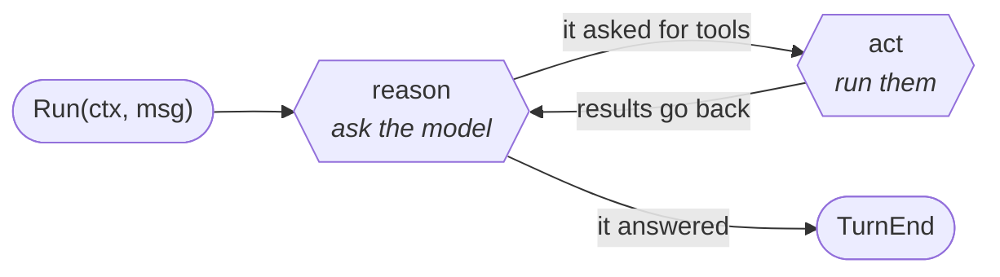
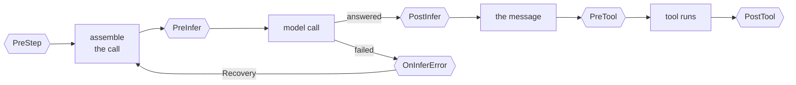

# sdk-go

[](https://pkg.go.dev/github.com/genai-io/sdk-go)
[](https://github.com/genai-io/sdk-go/actions/workflows/ci.yml)
[](go.mod)
[](LICENSE)

A Go SDK for large language models, in two packages: one typed API over six
protocols from Anthropic, OpenAI and Google, and an agent runtime that runs the
loop around it.

It is a set of building blocks for assembling agents — any agent, not one
application. What every agent needs lives here, once; an application keeps
only its own policy and UI. See [what belongs here](CONTRIBUTING.md#what-belongs-here).

**`pkg/ai` — one model call**

- **One API, six protocols** — the same types whichever provider serves the request.
- **Streaming** — text, thinking, tool calls and images on one start/delta/end lifecycle.
- **Tool calling** — the schema derived from your argument struct, and the call decoded back into it.
- **Structured outputs** — `CompleteAs[T]` derives the schema, constrains generation and decodes.
- **Typed errors** — auth, rate limit, context exceeded and unsupported, not substrings to match.
- **A vendor catalog** — 28 vendors: how to reach each one and speak its protocol, as data. Which models exist, their limits, prices, modalities and reasoning efforts are the application's to supply; the SDK spells each effort the way the protocol wants.
- **No ambient credentials** — `pkg/ai` reads no environment variable and no file.

**`pkg/agent` — the loop around it**

- **Reason and act** — call the model, run the tools it asks for, call it again.
- **Everything as events** — ten types on one sequence, and the conversation is the fold of two of them.
- **Four hooks** — refuse a tool call, rewrite what is sent, redact what came back.
- **Parallel tools** — a batch runs concurrently unless a tool says it cannot.
- **Sessions** — save an agent's conversation, and load it back.
- **MCP** — an MCP server's tools arrive as the agent's own, ready for `WithTools`.

[Installation](#installation) · [中文文档](README.zh-CN.md)

**[The client](#the-client--pkgai)** —
[Quickstart](#quickstart) ·
[Streaming](#streaming) ·
[Tool use](#tool-use) ·
[Structured outputs](#structured-outputs) ·
[Request options](#request-options) ·
[Messages](#messages-and-content) ·
[Errors](#errors-and-execution-policy) ·
[Credentials](#credentials) ·
[Protocols](#supported-protocols)

**[The agent](#the-agent--pkgagent)** —
[The loop](#the-loop) ·
[Events](#everything-is-an-event) ·
[Hooks](#hooks) ·
[Sessions](#sessions)

## Installation

```sh
go get github.com/genai-io/sdk-go
```

Requires Go 1.26.9 or later.

## The client — `pkg/ai`

One model call, over any of six protocols. Everything in this half works
without `pkg/agent`.

### Quickstart

```go
package main

import (
	"context"
	"fmt"
	"log"

	"github.com/genai-io/sdk-go/pkg/ai"
	"github.com/genai-io/sdk-go/pkg/ai/auth"

	_ "github.com/genai-io/sdk-go/pkg/ai/driver/openai/responses"
)

func main() {
	client, err := auth.Client("openai/gpt-4.1")
	if err != nil {
		log.Fatal(err)
	}

	response, err := client.Complete(context.Background(),
		[]ai.Message{ai.UserMessage("Explain goroutine leaks.")},
		ai.WithSystem("You are concise."))
	if err != nil {
		log.Fatal(err)
	}
	fmt.Println(response.Text())
}
```

`auth.Client` reads the credential from the environment variable the vendor
documents — `OPENAI_API_KEY` here. The blank import registers one wire
protocol; import only the ones you use, or `pkg/ai/driver/all` when the model
is chosen at run time.

This is the short end of one chain: `auth.Client` is `auth.Config` plus
`ai.New`, which builds the registered driver and wraps it in a client. Stop
earlier when you need to — a server that must not read ambient credentials
stops at `ai.New`, middleware builds the driver itself and hands it to
`ai.NewClientWithDriver`. See
[Constructing a client](docs/clients.md).

#### Switching providers

Change the reference. Nothing else changes.

```go
ref := "anthropic/claude-opus-5" // or google/gemini-3.5-flash,
                                 //    deepseek/deepseek-v4-pro, ollama/llama4
client, err := auth.Client(ref)
```

`catalog.All()` lists every vendor, without a network call; the models a vendor serves come from its live listing or from your own data.

Runnable examples are in [`examples/`](examples) — one per vendor, plus
[`structured/`](examples/structured) and five agents.

### Streaming

`Stream` returns an iterator of events. Every kind of content — text, thinking,
tool calls, images — uses the same start/delta/end lifecycle, so one loop
handles all of them.

```go
for event, err := range client.Stream(ctx, messages) {
	if err != nil {
		return err
	}
	switch event.Type {
	case ai.EventBlockStart:
		ui.Open(event.Index, event.Block.Type)

	case ai.EventBlockDelta:
		switch event.Block.Type {
		case ai.BlockText:
			ui.AppendText(event.Index, event.Block.Text)
		case ai.BlockThinking:
			ui.AppendThinking(event.Index, event.Block.Text)
		}

	case ai.EventBlockEnd:
		if event.Block.Type == ai.BlockToolCall {
			go runTool(*event.Block.ToolCall)
		}

	case ai.EventDone:
		response = event.Response
	}
}
```

`EventBlockDelta` carries a fragment, `EventBlockEnd` the complete block, and
`EventDone` the aggregated `Response` — the same value `Complete` returns.
Every block that opens is closed, including on failure. Abandoning the iterator
cancels the request.

### Tool use

A tool is a `Schema`: a name, a description, and the JSON its arguments take.
`ToolSchema` derives one from a struct, which is exactly what the model may
send.

```go
type SearchArgs struct {
	Query string `json:"query" description:"what to look for, in plain words"`
	Limit int    `json:"limit,omitempty" description:"how many passages to return" maximum:"10"`
}

search := ai.ToolSchema[SearchArgs]("search", "Search the documentation and return matching passages.")

response, err := client.Complete(ctx, messages, ai.WithTools(search, fetch))
for _, call := range response.ToolCalls() {
	var a SearchArgs
	err := search.Validate(call.Input) // the arguments against the schema
	err = call.UnmarshalArgs(&a)       // then into the struct it came from
}
```

`SearchArgs` is named once, so the schema sent to the model and the struct its
arguments decode into cannot disagree:

```json
{
  "type": "object",
  "properties": {
    "query": {"type": "string", "description": "what to look for, in plain words"},
    "limit": {"type": ["integer", "null"], "description": "how many passages to return", "maximum": 10}
  },
  "required": ["query", "limit"],
  "additionalProperties": false
}
```

`UnmarshalArgs` treats an argument the schema does not have as an error rather
than a silent drop — a model that invents one should be told, not obeyed
halfway — and reads an empty document as an empty object, which is what every
protocol here sends for a call to a tool that takes no arguments.

Constraining the choice is one value with four states, the same four every
protocol expresses:

```go
ai.WithToolChoice(ai.ToolChoiceNone)            // no tool this turn
ai.WithToolChoice(ai.ToolChoiceRequired)        // some tool, the model's choice which
ai.WithToolChoice(ai.ToolChoiceNamed("search")) // this one
```

`pkg/ai` makes one call. Running the tools and calling again until the model
stops asking is [the agent](#the-agent--pkgagent).

### Structured outputs

```go
type Person struct {
	Name string `json:"name" description:"full legal name, family name last"`
	Age  int    `json:"age" description:"age in whole years" minimum:"0"`
}

person, err := ai.CompleteAs[Person](ctx, client, messages)
```

The type is named once: `CompleteAs` derives the schema from it, constrains
generation natively, and decodes the answer into it. `WithSchema` and
`Response.Unmarshal` are the same two halves, for a schema you hold already.

A tag key is the JSON Schema keyword it sets — eleven of them — and every word
is prompt text. Schemas are derived to be *accepted*, not merely valid, which
is a stricter target than the specification. See
[`pkg/ai/jsonschema`](https://pkg.go.dev/github.com/genai-io/sdk-go/pkg/ai/jsonschema).

### Request options

The conversation is an ordinary `[]ai.Message`. Everything else is an `Option`,
and the same option is a default at construction and an override at the call:

```go
client, err := auth.Client("openai/gpt-4.1", ai.WithEffort(ai.EffortHigh)) // default

response, err := client.Complete(ctx, messages,
	ai.WithTemperature(0),
	ai.WithMaxTokens(4096),
	ai.WithEffort(ai.EffortLow), // overrides the default
	ai.WithCacheRetention(ai.CacheLong))
```

Passing an option is what marks a setting explicit, so `WithTemperature(0)` is
deterministic sampling and omitting it inherits. Resolution runs model
defaults, then client defaults, then call overrides.

`WithEffort` is a normalized rung. A model's `Reasoning` names the efforts it
offers; the SDK spells each one the way the endpoint's protocol wants — a token
budget, a level string, an enable flag — and snaps to the nearest one offered.
`Model.WireEfforts` lists what the protocol can tell apart.

### Messages and content

A message carries an ordered sequence of typed blocks rather than parallel
fields, because that order is what the next request has to replay.

```go
messages := []ai.Message{
	ai.UserMessage("What is in this image?", image),
	{Role: ai.RoleAssistant, Content: ai.TextContent("A gopher.")},
	ai.ToolResultsMessage(result),
}

text := response.Text()
history = append(history, response.Message()) // keeps every block, in order
```

A tool result is content too: text, and images where the protocol carries them
— a screenshot, a rendered chart. A call that puts one on the protocol that
would drop it is refused before it is sent, rather than letting the model answer about a
picture it was never shown.

Append `response.Message()`, not a message rebuilt from `response.Text()` —
the first carries thinking and reasoning state forward, which is what lets a
reasoning model resume instead of starting over.

### Errors and execution policy

Failures are classified, so the answer to "what now" is in the type rather than
in the message text:

```go
switch {
case ai.IsAuth(err):            // the credential is wrong or missing
case ai.IsContextExceeded(err): // compact the conversation and retry
case ai.IsRetryable(err):       time.Sleep(ai.RetryAfter(err))
case ai.IsKind(err, ai.KindUnsupported): // this model cannot do what was asked
}
```

A failed turn returns a non-nil error *and* a non-nil `*Response` with what
arrived, so a partial answer and its cost are not lost. Requests are validated
before they leave, and never rewritten to make them work: a model with no
system role is an error naming the model, because moving those instructions
into a user turn is a decision about your product.

Every driver disables its vendor SDK's own retries, so a call is tried once.
Retry is the agent's `WithRetry`, or your own loop on `IsRetryable`; caching,
logging and metering stay yours.

### Credentials

`pkg/ai` never reads an environment variable or a file, which is what makes it
safe in a server holding several tenants' keys:

```go
model.BaseURL = "https://gateway.internal/v1"
model.Headers = map[string]string{"X-Tenant": tenant}
client, err := ai.New(ai.Config{Model: model, APIKey: key, HTTPClient: httpClient})
```

Where a request goes and what it carries are the model's: `Model.BaseURL` and
`Model.Headers` are the final values, so whoever builds the Config writes an
override onto the model.

`pkg/ai/auth` is the opt-in that does read it. `pkg/ai/endpoint` sits between a
catalog row and a client: one configured host and the models on it, where
reading the list and fetching it are separate verbs.

### Supported protocols

| Protocol | Package | Vendors in the catalog |
| --- | --- | --- |
| OpenAI Chat Completions | `pkg/ai/driver/openai/chat` | 18 |
| OpenAI Responses | `pkg/ai/driver/openai/responses` | 3 |
| Anthropic Messages | `pkg/ai/driver/anthropic` | 4 |
| Anthropic on Vertex AI | `pkg/ai/driver/anthropic/vertex` | 1 |
| Google Gemini | `pkg/ai/driver/google` | 1 |
| Google Gemini on Vertex AI | `pkg/ai/driver/google/vertex` | 1 |

A vendor is a catalog row, not a package: most ship an endpoint speaking
somebody else's protocol, so adding one is a data change.

## The agent — `pkg/agent`

The loop around that call: ask the model, run the tools it asks for, ask
again. Everything in this half is built on the half above and adds nothing
to it — an agent holds an `ai.Client` and calls `Stream`.

### The loop

`pkg/ai` makes one model call. `pkg/agent` runs the loop around it: ask the
model, run the tools it asks for, ask again, until the model answers without
asking for anything more. That whole thing is one **turn**, and it holds as
many model calls as the tools require.



`Run` advances the conversation by exactly one turn and reports what it does as
it goes. The last event is `TurnEnd`, which says how it went.

```go
a, err := agent.New(client,
    agent.WithSystem("You are a careful assistant."),
    agent.WithTools(readFile, listDir),
)
if err != nil {
    log.Fatal(err)
}

for e, err := range a.Run(ctx, ai.UserMessage("what does main.go do?")) {
    render(e)
}
```

**Repeating it is your `for` loop.** A CLI reads stdin, an interface reads keys,
a server reads requests, and none of those is a shape a library should guess —
so how messages are batched into turns, what a failure means and when to stop
are all yours:

```go
for batch := range myMessages {
    for e, err := range a.Run(ctx, batch...) { render(e) }
}
```

`AddMessages` puts something into the turn already running; `Interrupt`, or
simply breaking out of the range, ends it.
Queued input enters the conversation before `TurnEnd`, including on failure or
cancellation, so recording the events and restoring `Messages()` retain it.

### Everything is an event

Twelve types on one sequence, and the set is closed — a consumer switching over
it knows the list is all there is. What takes time is a span, and each reports
the same way: it starts, it may report as it goes, it ends.

```
MessageAdded     MessagesReplaced                the conversation changing
InferenceStart   InferenceUpdate  InferenceEnd   one model call
ToolStart        ToolUpdate       ToolEnd        one tool call
CompactionStart                   CompactionEnd  the conversation being shortened
TurnStart                         TurnEnd        the turn around them
```

**The conversation is the fold of the first row.** Replay `MessageAdded` in
order and you have what the agent holds; a `MessagesReplaced` starts the fold
over, because everything before one is what the agent threw away.

Every event carries the turn it belongs to, and every closing event carries
what opened it — so reading one is reading, not remembering.

### Hooks

Six places to get between the loop and the model. **Hooks are asked; events
are told.**



A permission system is a `PreTool` returning `Decision{Block: true}`. A batch of
tool calls runs concurrently unless a tool declares it cannot, and a tool that
panics fails the way any tool fails — the model is told and the turn carries on.

Compaction is a `PreStep`: the loop hands over the conversation and what sending
it would cost, and what a shorter one should say is yours.

Retry is off by default; `WithRetry` turns it on. What a replay cannot
fix — a prompt over the window, a key out of quota — is `OnInferError`, which
answers a failed call with a shorter conversation and another go at the step.

### Sessions

The agent never learns storage exists. A conversation is a `[]ai.Message`:
load it, hand it over, save what the agent holds afterwards.

```go
history, _ := store.Load(ctx, id)        // session.ErrNotFound if new
a.SetMessages(history)
for e, err := range a.Run(ctx, ai.UserMessage(line)) {
    render(e)
}
store.Save(ctx, id, a.Messages())        // the whole conversation
```

`pkg/session` is that `Store`, and `pkg/session/jsonl` keeps one append-only
file per conversation.

Compaction needs nothing more: the next save is the compacted conversation.

See [the Agent SDK](docs/agent.md) for the event contract, the hook composition
rules, tools and sessions, and [`examples/agent-chat`](examples/agent-chat),
[`examples/agent-progress`](examples/agent-progress),
[`examples/agent-session`](examples/agent-session),
[`examples/agent`](examples/agent) and [`examples/mcp`](examples/mcp) for
programs that run.

## Documentation

**The client** — `pkg/ai`, one model call

| | |
| --- | --- |
| [API reference](https://pkg.go.dev/github.com/genai-io/sdk-go/pkg/ai) | Every type and function, with the rationale beside the code it governs |
| [Constructing a client](docs/clients.md) | One chain from a model reference to an `ai.Client`, and where to stop on it ([中文](docs/clients.zh-CN.md)) |
| [Architecture](docs/architecture.md) | How the pieces fit and what a request passes through ([中文](docs/architecture.zh-CN.md)) |

**The agent** — `pkg/agent`, the loop around it

| | |
| --- | --- |
| [API reference](https://pkg.go.dev/github.com/genai-io/sdk-go/pkg/agent) | The agent, its events, its hooks and its tools |
| [The Agent SDK](docs/agent.md) | Structure, the event contract, hooks, tools and sessions ([中文](docs/agent.zh-CN.md)) |

**The project**

| | |
| --- | --- |
| [Contributing](CONTRIBUTING.md) | Development setup, implementing a protocol, and the test suite |
| [Changelog](CHANGELOG.md) | What changed in each release |
| [`examples/`](examples) | Runnable programs: one per vendor, plus structured output and five agents |

## Versioning

Released under [semantic versioning](https://semver.org). While the major
version is `0` the API may still change between minor releases; the
[changelog](CHANGELOG.md) says what moved and what to write instead.

```sh
go get github.com/genai-io/sdk-go@v0.8.0
```

## License

[Apache 2.0](LICENSE)
